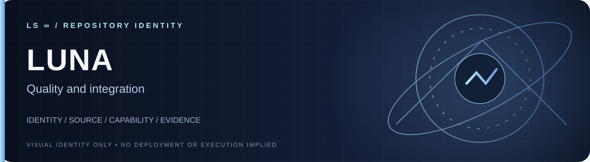

**Quality and integration.**

[**Explore source**](.) · [**Repository details**](../../)

**Visibility:** `PUBLIC` · **Identity:** `LIVE IN GITHUB` · **Deployment:** `NOT ASSERTED BY BANNER`

---

# LS-luna
LS Luna - Quality and Integration
